# Zenith
An offline tracker for lifters and students that logs workouts, meals, sleep, water and study in one app.
```bash
git clone https://github.com/apurvamukherjee/Zenith-Own-the-peak && cd Zenith-Own-the-peak && npm i && npm run dev
```

[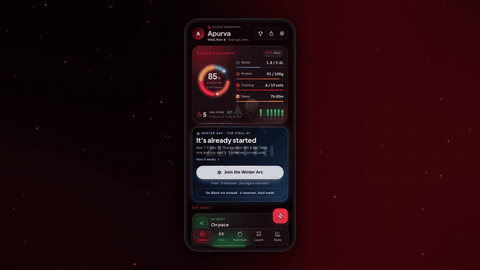](docs/cinematic.mp4)

▶ **[Watch the cinematic](docs/cinematic.mp4)** · **[Download MP4](https://github.com/apurvamukherjee/Zenith-Own-the-peak/raw/main/docs/cinematic.mp4)** (52 s, 1080p, original soundtrack). It's recorded from the live app by [`scripts/cinematic`](scripts/cinematic/).

**Try it without installing:** [zenith-own-the-peak.vercel.app](https://zenith-own-the-peak.vercel.app) · [Android APK](https://github.com/apurvamukherjee/Zenith-Own-the-peak/releases/latest)

<div align="center">

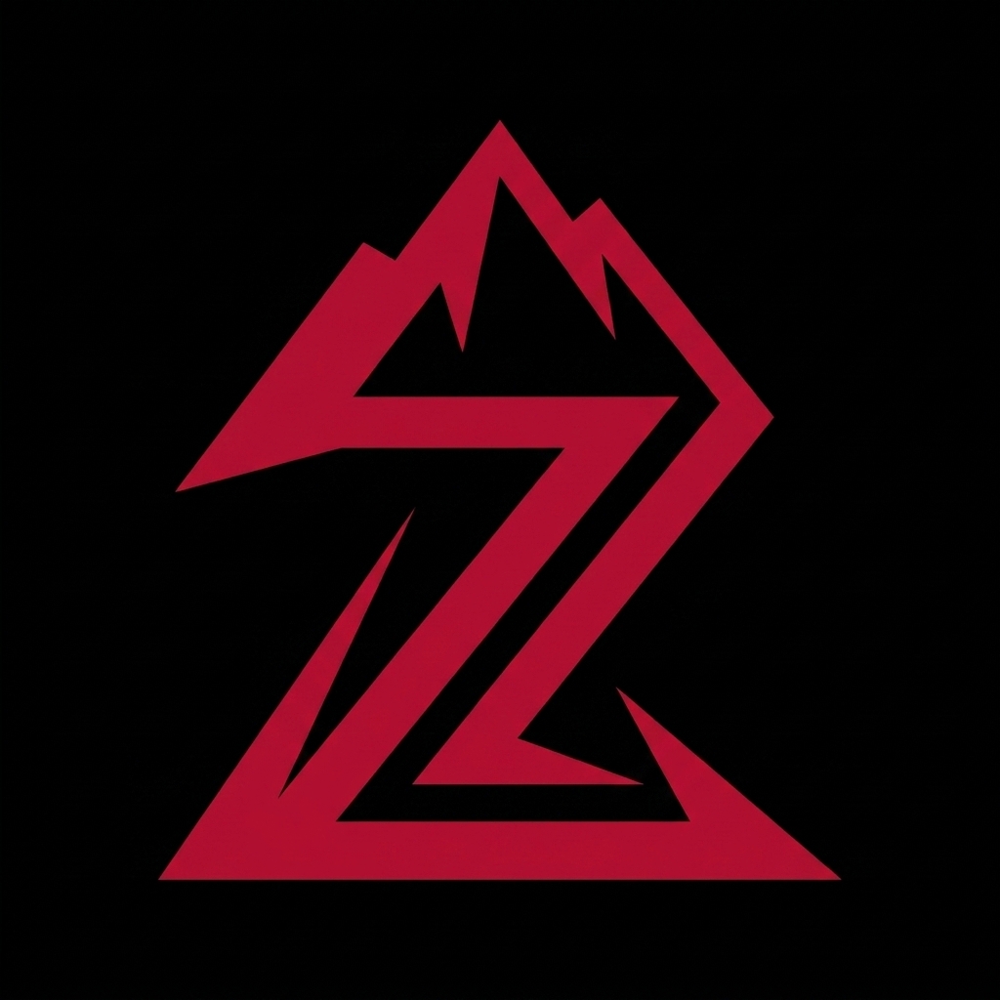

### *Own the peak.*

A local-first personal tracker for **training, nutrition, sleep, water, study, spending, bike fuel and a full calendar**, in one gothic, offline dashboard. No account and no server: your data never leaves your device unless you turn on sync.

[](https://github.com/apurvamukherjee/Zenith-Own-the-peak/actions/workflows/ci.yml)


**21 screens · 148-exercise library · 3 built-in training splits · 100 achievements · 21 levels · zero backend required**

</div>

---

## 📸 See it in action

<table>
<tr>
<td width="25%">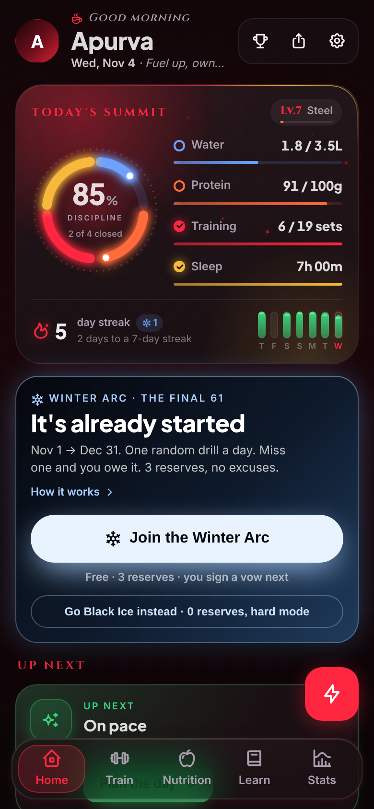</td>
<td width="25%">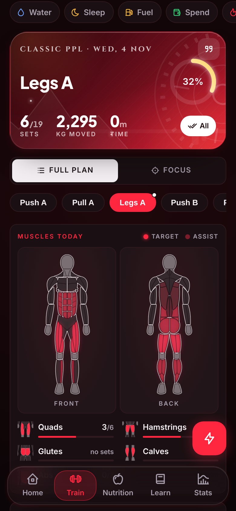</td>
<td width="25%">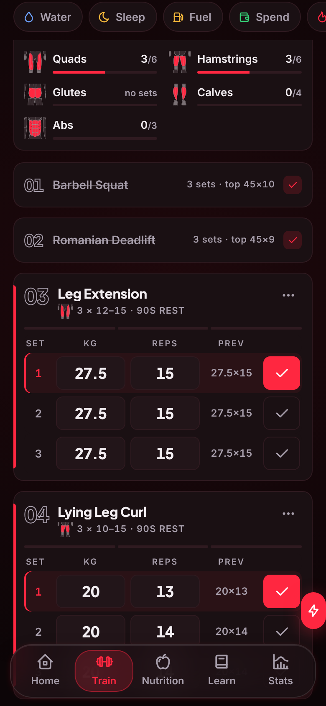</td>
<td width="25%">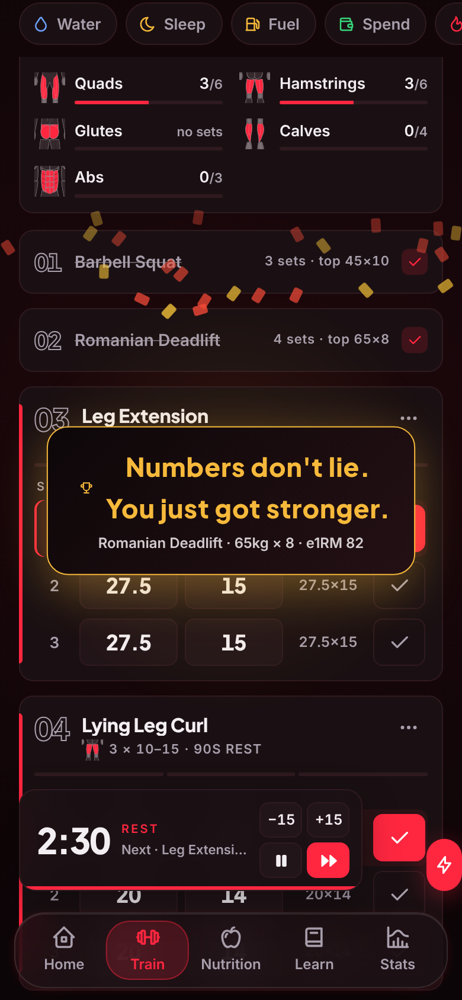</td>
</tr>
<tr>
<td align="center"><sub><b>Home</b>: today's summit, the discipline score</sub></td>
<td align="center"><sub><b>Train</b>: your plan, pre-filled</sub></td>
<td align="center"><sub><b>Log a set</b>: one tap, rest starts itself</sub></td>
<td align="center"><sub><b>New PR</b>: a brutal one-liner every time</sub></td>
</tr>
<tr>
<td width="25%">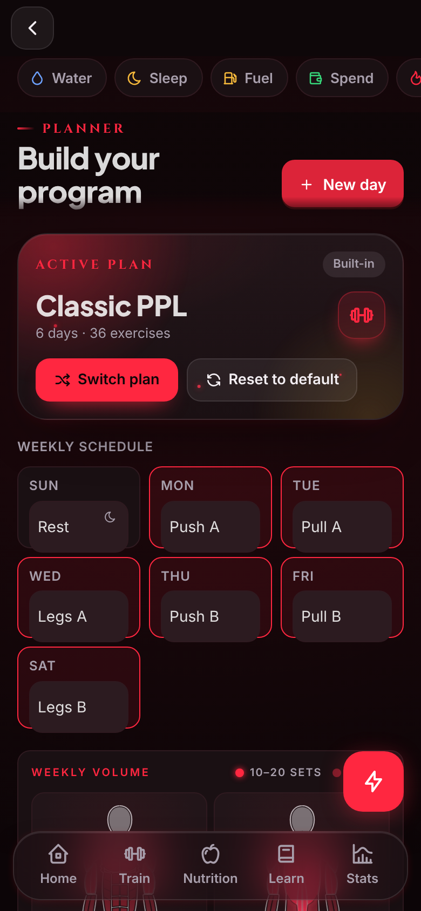</td>
<td width="25%">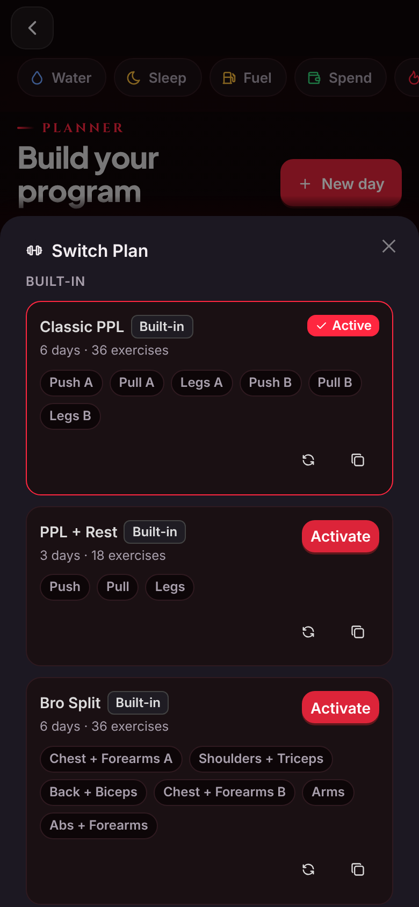</td>
<td width="25%">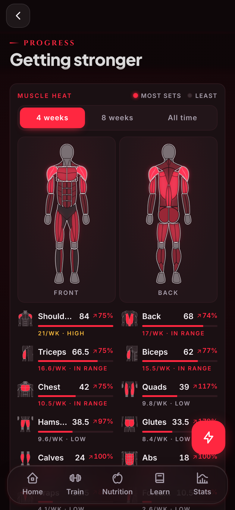</td>
<td width="25%">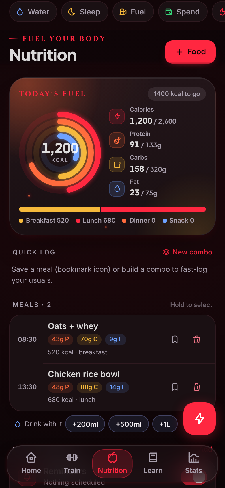</td>
</tr>
<tr>
<td align="center"><sub><b>Planner</b>: build your week</sub></td>
<td align="center"><sub><b>Switch plan</b>: flip splits in one tap</sub></td>
<td align="center"><sub><b>Progress</b>: muscle heat and e1RM trends</sub></td>
<td align="center"><sub><b>Nutrition</b>: macros by weight</sub></td>
</tr>
<tr>
<td width="25%">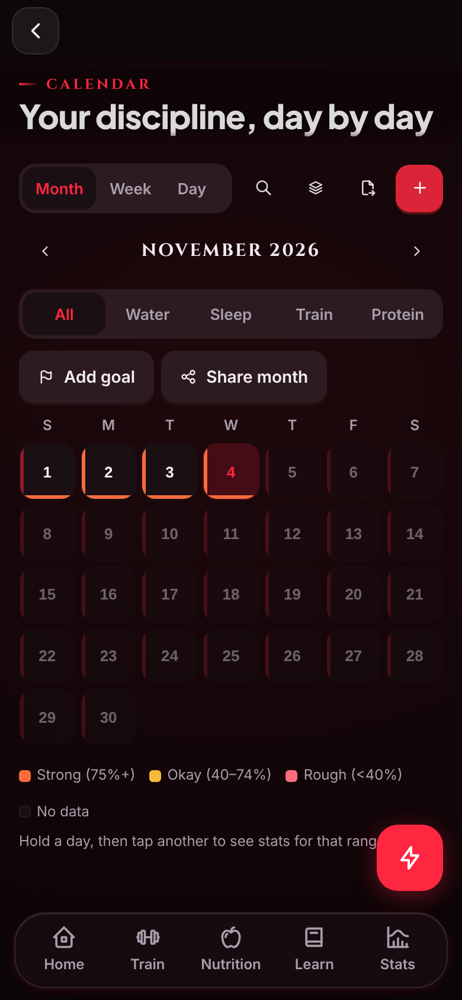</td>
<td width="25%">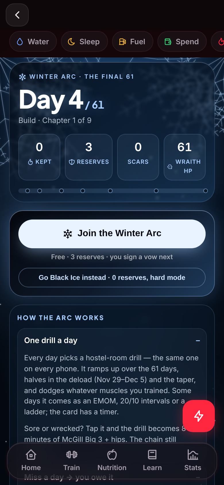</td>
<td width="25%">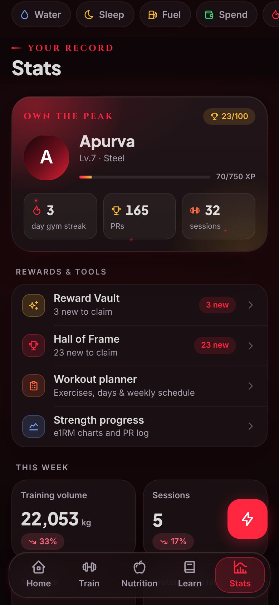</td>
<td width="25%">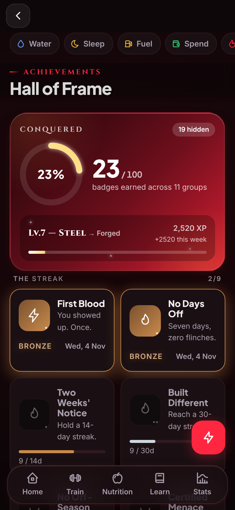</td>
</tr>
<tr>
<td align="center"><sub><b>Calendar</b>: discipline, day by day</sub></td>
<td align="center"><sub><b>Winter Arc</b>: the final 61</sub></td>
<td align="center"><sub><b>Stats</b>: insights that matter</sub></td>
<td align="center"><sub><b>Hall of Frame</b>: 100 badges to earn</sub></td>
</tr>
<tr>
<td width="25%">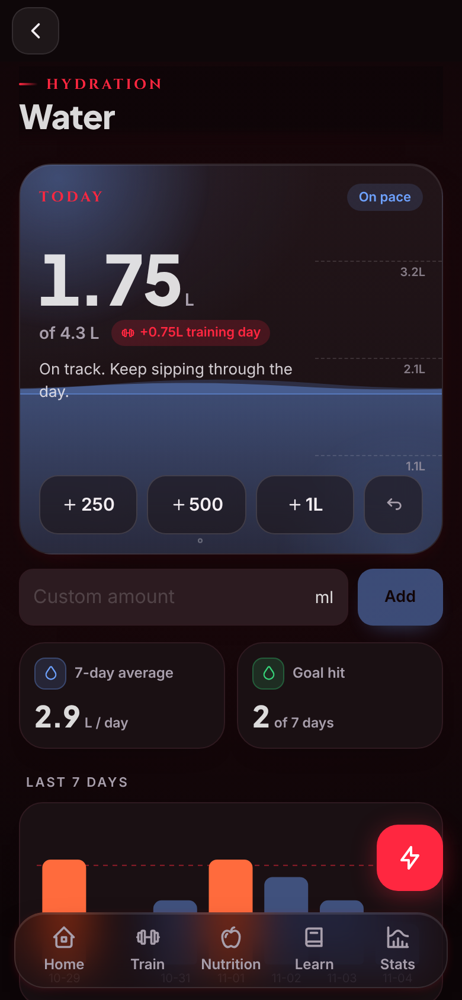</td>
<td width="25%">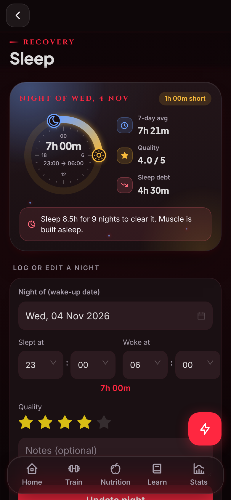</td>
<td width="25%">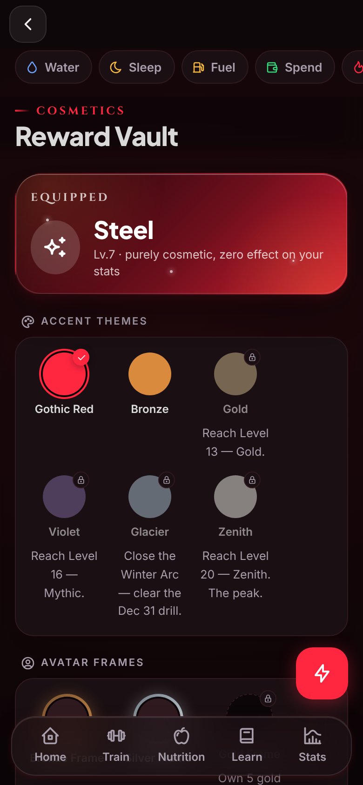</td>
<td width="25%"></td>
</tr>
<tr>
<td align="center"><sub><b>Water</b>: pace-aware hydration</sub></td>
<td align="center"><sub><b>Sleep</b>: bed, wake, quality, debt</sub></td>
<td align="center"><sub><b>Reward Vault</b>: themes, frames, titles</sub></td>
<td></td>
</tr>
</table>

---

## ✨ Highlights

- 🏋️ **Switchable training plans.** 3 built-in splits (Classic PPL, PPL + Rest, Bro Split) plus unlimited custom plans. Each is a full 7-day program you build once and switch to in one tap. Switching saves the plan you're leaving.
- ⚡ **Fast gym logging.** A set table (SET · KG · REPS · PREV · ✓) pre-filled from your last session. One tap logs a set and starts the rest dock (±15 s, pause, skip, "next up"). You can tap a set to edit it or swipe it away with Undo. It also has drop sets, mid-workout supersets, today-only reorder and skip, and an end-of-workout summary you can share.
- 🫀 **Body map.** An anatomical front/back map that lights up as you finish sets, shows weekly volume per muscle in the Planner, and shows muscle heat over 4 weeks, 8 weeks or all time in Progress.
- 🔒 **Focus Mode.** One set at a time, fullscreen, when you want zero distractions.
- 📊 **Discipline score.** One number on Home for whether today is on track: water, training, sleep and protein, averaged.
- 🏆 **PR celebrations and level-ups.** Every PR fires a full-bleed one-liner, and levels get a cinematic screen. PR flags stay correct even when you edit or delete sets.
- ❄️ **Winter Arc (Nov 1 – Dec 31).** A 61-day event with a seeded daily drill that ramps up and works around muscles you've already trained. A missed day becomes debt you owe back, with reserves to cover it. It adds weekly bosses, Trials, a wager, a frost map of all 61 days, and a Wrapped recap.
- 📅 **Full Month/Week/Day calendar.** Built on a unified tasks and events system: draw-to-create time blocks, recurring events, all-day and multi-day spans, layers, search, ICS export, and two-way Google Calendar sync.
- ⚡ **XP and levels.** Every action earns XP, across 21 levels from Unranked to Zenith.
- 🏆 **100 achievement badges** in 5 tiers (bronze → mythic), 19 of them mystery, all earned by real milestones.
- 🎁 **Reward Vault.** Unlock accent themes, avatar frames and titles as you level up.
- 🏅 **Social leaderboard.** Follow friends by share code and compete on weekly discipline, streak and volume.
- 💸 **Spending.** A war-chest budget by category, with quick logging from anywhere.
- ⚡ **Quick-log button.** On every screen, it logs water, a meal, an expense or a voice entry in one tap. It tucks into an edge tab while you scroll, so it never covers your content.
- 🖤 **Gothic dark mode** by default (black + aggressive red), with a one-tap light toggle.
- ☁️ **Optional cloud sync.** Backup with email-code login and auto-push on change, loaded only when you set it up.
- 🔔 **Smart reminders.** Adaptive copy ("you're 700 ml behind") and native push on mobile.
- 💾 **You own the data.** One-tap JSON backup and restore, plus an AES-encrypted export.

## 🥊 Built-in training plans

| Plan | Split | Days/week |
|---|---|---|
| **Classic PPL** | Push A · Pull A · Legs A · Push B · Pull B · Legs B | 6 |
| **PPL + Rest** | Push · Pull · Legs · Rest · Push · Pull · Legs | 6 |
| **Bro Split** | Chest+Forearms · Shoulders+Triceps · Back+Biceps · Chest+Forearms · Arms · Abs+Forearms · Rest | 6 |

Every day ships with hand-picked exercises, sets, rep ranges and rest timers from the 148-exercise library. Swap any exercise, tweak the numbers, or build a plan from scratch. You can also import or export a whole program as JSON ([format](docs/WORKOUT_PLAN_FORMAT.md)).

## 📦 Modules

| | Module | What it tracks |
|---|---|---|
| 🏠 | **Home** | Discipline score, unified streak, today's training, water, sleep, Winter Arc drill, up-next |
| ⚡ | **Train** | Session logger: set table, rest dock, supersets, today-only order and skips, summary |
| 📋 | **Planner** | Build days, pick exercises, weekly schedule, weekly muscle volume, switch plans |
| 📈 | **Progress** | Per-exercise e1RM trend, volume, PR log, muscle heat |
| 🍽️ | **Nutrition** | Meals and macros from an Indian-first food catalog, combos, copy yesterday |
| 📚 | **Study** | Learning paths, topic backlog, auto "up next", time logging |
| 💧 | **Water** | Pace-aware hydration, a bigger goal on training days, 7-day chart |
| 😴 | **Sleep** | Bed and wake logging, quality, sleep debt |
| ⛽ | **Fuel** | Full-to-full bike mileage (km/L), monthly spend, cost per km |
| 💸 | **Spending** | Monthly budget by category |
| 🔥 | **Habits** | Trigger → action chains you keep unbroken |
| ✅ | **Tasks** | List and kanban views with natural-language quick-add ("gym tomorrow 7am") |
| 📅 | **Calendar** | Month/Week/Day views, events, discipline overlay, Google Calendar sync |
| ❄️ | **Winter Arc** | Daily drill, reserves, bosses, frost map, chapters, badges |
| 💬 | **Motivation** | Swipeable quote deck by category: add, edit, favorite |
| 🏆 | **Hall of Frame** | 100 achievements (19 mystery), with live progress on everything still locked |
| 🎁 | **Reward Vault** | Accent themes, avatar frames and titles |
| 🏅 | **Leaderboard** | Friends by share code, weekly discipline and volume |
| 📊 | **Stats** | Weekly review, year heatmap, photo timeline, efficiency, body composition |
| ⚙️ | **Settings** | Profile and daily targets, appearance, reminders, cloud sync, backup |

## 🛠 Tech stack

**React 19** · **TypeScript (strict)** · **Vite 5** · **Ant Design 5** · **Dexie (IndexedDB)** · **Framer Motion** · **Recharts** · **react-icons (Tabler)** · **React Router 6** · **dayjs** · **Capacitor** (Android/iOS) · optional **Convex** (sync, leaderboard, Google Calendar)

## 🚀 Quick start

```bash
npm install
```

```bash
npm run dev        # prints Local + Network URL
```

On your phone (same Wi-Fi), open the **Network** URL.

```bash
npm test           # node --test: Winter Arc logic, PR flags, gym grouping, muscle load
```

```bash
npm run build      # typecheck + production build → /dist
```

CI runs the typecheck, the tests and the build on every pull request, and a tag push builds and publishes a signed APK ([docs/RELEASING.md](docs/RELEASING.md)).

## ☁️ Deploy

Import the repo on **Vercel** with the framework preset **Vite**, then deploy. It's fully static, so no environment variables are needed unless you turn on optional cloud sync ([DEPLOYMENT.md](DEPLOYMENT.md), [Google Calendar setup](docs/GOOGLE_CALENDAR_SYNC.md), [leaderboard guide](docs/LEADERBOARD_GUIDE.md)). Without `VITE_CONVEX_URL`, the cloud code is never downloaded.

## 📲 Native app

This repo is the only source for the Android and iOS apps. Capacitor bundles
`dist/` into the native projects in `android/` and `ios/`, so the app works offline.

```bash
npm run apk   # signed release APK → android/app/build/outputs/apk/release/
```

```bash
npm run ios   # build, sync and open Xcode
```

**Releases are automated.** Push a version tag such as `v1.5.0`, and GitHub Actions builds the APK, signs it with the release key (stored as repository secrets) and publishes it under [Releases](https://github.com/apurvamukherjee/Zenith-Own-the-peak/releases). Setup and the release checklist are in [docs/RELEASING.md](docs/RELEASING.md).

## 🧱 Architecture

```
UI (features/*/*.tsx)        ← presentational only
  └─ data hooks (use*.ts)    ← the ONLY place data is read/written
       └─ db (IndexedDB)     ← typed, versioned tables + export/import
```

Every write fires a small mutation bus. Auto-backup, the XP engine and the achievement engine listen to it, filtered to the tables each one actually reads. More detail is in [ARCHITECTURE.md](ARCHITECTURE.md).

## 🎬 The cinematic

[`docs/cinematic.mp4`](docs/cinematic.mp4) is generated, not hand-edited. [`scripts/cinematic`](scripts/cinematic/) seeds six weeks of demo history in a throwaway browser and records a scripted walkthrough of the live app. It then synthesizes the soundtrack in code and composites captions and an end card. Re-run it after UI changes to keep the video current.

## 🔒 Privacy

Your logs stay on your device by default, and no account is required. The hosted web version counts anonymous page views with Vercel Web Analytics (no cookies, none of your logged data). Cloud sync is entirely optional and off unless you turn it on.

## 📄 License

[MIT](LICENSE)

<div align="center"><sub>Built with discipline · by Apurva</sub></div>
